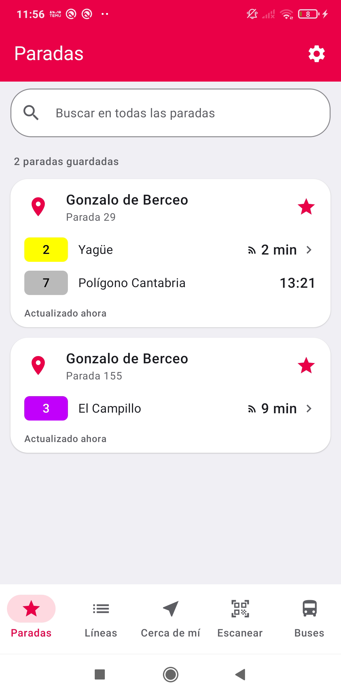
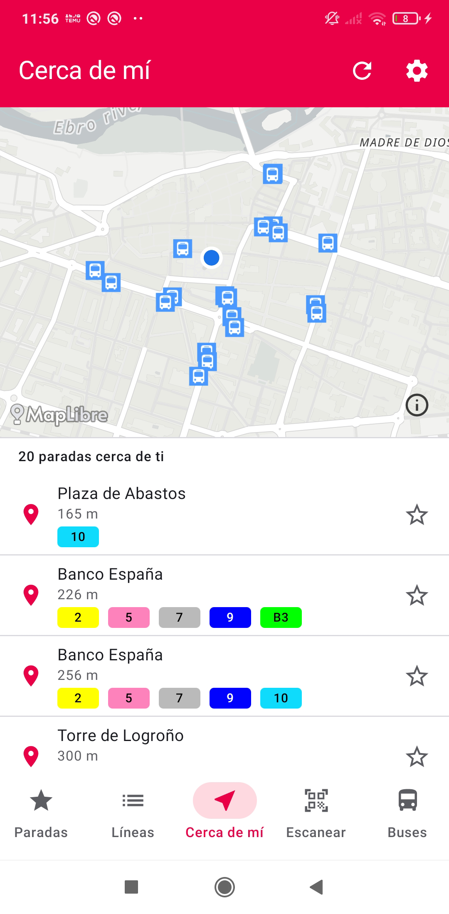
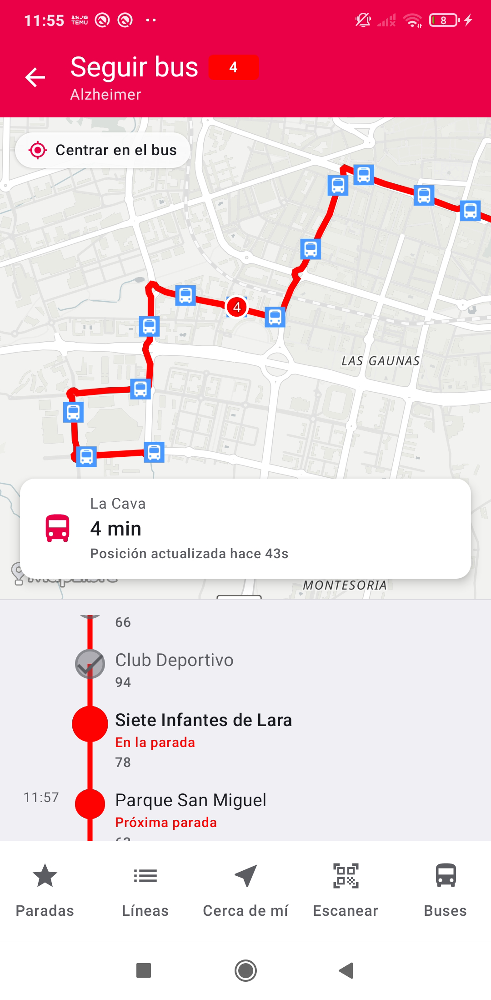
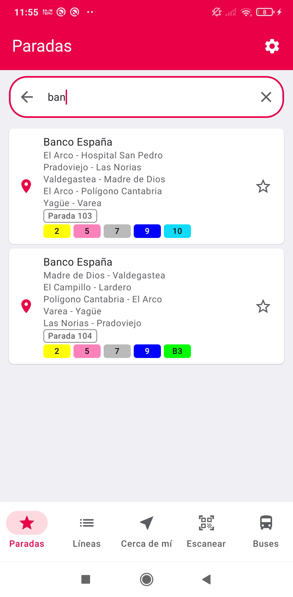
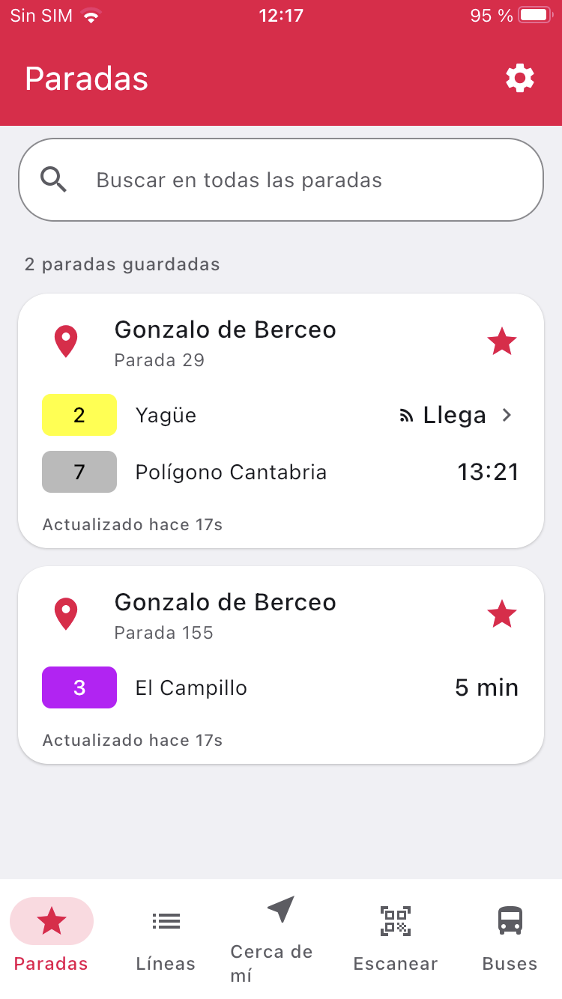
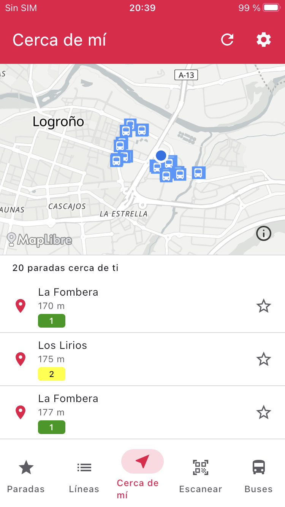
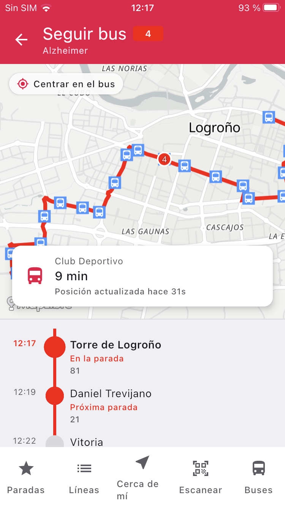
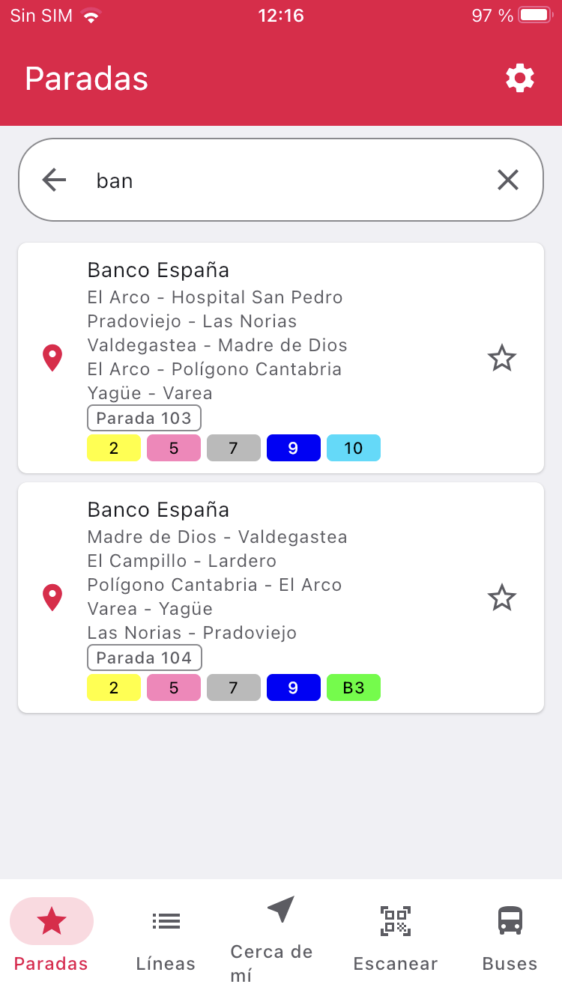

**English** · [Español](README.es.md)

Logroño Bus App
==============

Logroño Bus is an app for checking the urban buses in Logroño. It shows the next departures from the
stops you save, the stops around you, where each bus is on the map, and a search over every stop in
the network. It can also read a stop sign with the camera.

> [!IMPORTANT]
> This is a personal, **unofficial** project. It is not related to the Ayuntamiento de Logroño (the
> city council) or to the company that runs the buses. The data comes from the council's public web
> service, with GTFS timetables and GTFS-Realtime updates.

The UI is written once with Compose Multiplatform and runs on Android, iOS, desktop and web.

If you want to see how the code is organised, there are two documents: the
[modularization guide](docs/ModularizationLearningJourney.md) and the
[architecture guide](docs/ArchitectureLearningJourney.md). Both have a
[Spanish](docs/ArchitectureLearningJourney.es.md) version.

# Features

- **Saved stops.** The next departures from each stop you follow, with the line colour and the delay.
- **Near you.** The closest stops and how long they are on foot.
- **Tracking.** The bus on the map, with its route and the arrival time at each stop. When it reaches
  the terminus, the trip is closed.
- **Search.** Find a stop by name and open its departures.
- **Scanner.** Read the code on the stop sign with the camera.
- **Buses, lines and fares.** Which buses are running, the lines of the network and the fares.

## Screenshots

**Android (Jetpack Compose)**

<table>
  <tr>
    <td></td>
    <td></td>
    <td></td>
    <td></td>
  </tr>
  <tr>
    <td align="center">Saved stops</td>
    <td align="center">Near you</td>
    <td align="center">Tracking</td>
    <td align="center">Search</td>
  </tr>
</table>

**iOS (Compose Multiplatform)**

<table>
  <tr>
    <td></td>
    <td></td>
    <td></td>
    <td></td>
  </tr>
  <tr>
    <td align="center">Saved stops</td>
    <td align="center">Near you</td>
    <td align="center">Tracking</td>
    <td align="center">Search</td>
  </tr>
</table>

The same UI also runs on desktop and web.

# Development environment

The project uses Gradle through the wrapper. You need:

- **JDK 17**, the toolchain of every module.
- **Android Studio** with the Android SDK 37, for the Android app, the desktop app and the web app.
- **Xcode**, for the iOS app (the project is in [`/iosApp`](./iosApp)).

Open the repository root in your IDE and let it import the project. The versions that matter are in
[`gradle/libs.versions.toml`](./gradle/libs.versions.toml).

# Libraries

| Library | What it is for |
|---|---|
| [Kotlin Multiplatform](https://kotlinlang.org/docs/multiplatform.html) | The code shared by Android, iOS, desktop and web |
| [Compose Multiplatform](https://www.jetbrains.com/compose-multiplatform/) | The UI, written once |
| [Material 3](https://m3.material.io/) | The visual system, adaptive variants included |
| [AndroidX Lifecycle](https://developer.android.com/jetpack/androidx/releases/lifecycle) | The view model and the state the screen observes |
| [Activity Compose](https://developer.android.com/jetpack/androidx/releases/activity) | The Android entry point |
| [Koin](https://insert-koin.io/) | Dependency injection resolved at compile time |
| [Ktor](https://ktor.io/) | HTTP client, with an engine per platform |
| [Ktorfit](https://github.com/Foso/Ktorfit) | Endpoints declared as interfaces |
| [kotlinx.serialization](https://github.com/Kotlin/kotlinx.serialization) | JSON and navigation keys |
| [kotlinx.coroutines](https://github.com/Kotlin/kotlinx.coroutines) | Concurrency and flows |
| [kotlinx-datetime](https://github.com/Kotlin/kotlinx-datetime) | Dates and times |
| [kotlinx-collections-immutable](https://github.com/Kotlin/kotlinx.collections.immutable) | Immutable collections in the state |
| [kotlinx-io](https://github.com/Kotlin/kotlinx-io) | Bytes and files, underneath DataStore |
| [kotlinx-browser](https://github.com/Kotlin/kotlinx-browser) | Browser APIs on the web target |
| [Navigation 3](https://developer.android.com/guide/navigation/navigation-3) | The back stack, which gets saved |
| [NavigationEvent](https://developer.android.com/guide/navigation/custom-back/predictive-back-gesture) | The back gesture |
| [Room](https://developer.android.com/kotlin/multiplatform/room) | The local database, with the native driver or the browser one |
| [DataStore](https://developer.android.com/topic/libraries/architecture/datastore) | Preferences |
| [MapLibre Compose](https://github.com/maplibre/maplibre-compose) | The map on Android, iOS and web |
| [JetLime](https://github.com/pushpalroy/jetlime) | The tracking timeline |
| [CameraX](https://developer.android.com/media/camera/camerax) | The scanner camera, on Android |
| [ML Kit](https://developers.google.com/ml-kit/vision/text-recognition/v2) | Reading the code on the stop sign on Android |
| [Vision](https://developer.apple.com/documentation/vision) | Reading the code on the stop sign on iOS |
| [Grant](https://github.com/brewkits/Grant) | Camera and location permissions |
| [Play Services Location](https://developers.google.com/android/reference/com/google/android/gms/location/package-summary) | Location on Android |
| [CoreLocation](https://developer.apple.com/documentation/corelocation) | Location on iOS |
| [Napier](https://github.com/AAkira/Napier) | Logs, with each platform's logger |
| [kotlin-test](https://kotlinlang.org/api/core/kotlin-test/) and [coroutines-test](https://kotlinlang.org/api/kotlinx.coroutines/kotlinx-coroutines-test/) | The test framework |
| [Turbine](https://github.com/cashapp/turbine) | Checking flows in tests |

# Architecture

The code is split into layers: model, domain, data and presentation, with dependencies pointing one
way. The UI, written once with Compose Multiplatform, lives in two modules: the design system and the
shared components.

How each layer is organised, what it may do and what it must not, is in the
[architecture guide](docs/ArchitectureLearningJourney.md).

# Modularization

The project is split into three kinds of Gradle modules: `core`, features and applications. Almost
all of them share plugins, targets and dependencies through convention plugins, and each module
carries its dependency graph in its own README.

The detail is in the [modularization guide](docs/ModularizationLearningJourney.md).

# Build

| Platform | Module | How to run it |
|---|---|---|
| Android | `:androidApp` | `./gradlew :androidApp:assembleDebug` leaves the APK in `androidApp/build/outputs/apk/debug/` |
| iOS | `/iosApp` | open the project in Xcode and run it from there |
| Desktop | `:desktopApp` | `./gradlew :desktopApp:run` |
| Web | `:webApp` | `./gradlew :webApp:wasmJsBrowserDistribution` leaves the bundle in `webApp/build/dist/wasmJs/productionExecutable` |

The iOS app is the only one not built by Gradle, because it needs Xcode to link the framework.

The Android `versionCode` and `versionName` come from `-PversionNum` when you pass it. For a release
build, the keystore is read from `keystore.properties`.

Spotless keeps the build tidy: ktlint enforces the style. `./gradlew spotlessCheck` verifies it and
`./gradlew spotlessApply` rewrites whatever does not comply.

# Tests

Data components are declared as interfaces, so a test can replace the real implementation with a fake
without touching production code. The fakes live in `core:testing` and nowhere else.

Every layer is tested: the domain rules, the mappers and the view models. On top of that, integration
tests use the real repositories against a stubbed backend and go all the way to the view model.

Tests that work on any platform live in `commonTest` and run on all of them. The ones using the stubbed
backend live in `jvmTest`: that backend wires the whole app, real preferences included, and on the JVM
those preferences write to a file.

## Why fakes and not mocks

There are two reasons.

The technical one is that a mock is built at runtime, and that depends on the JVM: Kotlin/Native links
the binary ahead of time and wasm has no reflection. With MockK, those tests only compile for the JVM
and the other platforms are left with an empty task, silently. There are libraries that generate
fakes with an annotation processor or a compiler plugin, but that is another piece in the build to
get what a hand-written file already does
([well explained here](https://blogs.mobilebytesensei.com/blog/a-fake-beats-a-mock-in-commontest/)).

The design one is the same [Now in Android](https://github.com/android/nowinandroid#testing) gives: a
mock checks **how** the code talks to its dependency (which method, how many times, in what order), and
that ties the test to the implementation; any refactor breaks it even when the behaviour is unchanged. A
fake behaves like the real thing but simplified, with hooks to set up the scenario, and the check is on
the state the user would see.

## Where they run

| Where | Command |
|---|---|
| JVM, every module | `./gradlew jvmTest` |
| JVM, one module | `./gradlew :feature:tracking:jvmTest` |
| Android host | `./gradlew testAndroidHostTest`, only `shared` |
| Android device | `./gradlew :core:database:connectedAndroidDeviceTest`, with the phone plugged in and USB debugging on |
| iOS simulator | `./gradlew :shared:iosSimulatorArm64Test`, on an Apple Silicon Mac |
| Browser | `./gradlew wasmJsBrowserTest`, through Karma |

`LIVE_API=1 ./gradlew jvmTest` adds the probes that hit the real service. Without that variable they are
skipped, so the normal build does not depend on the network.

# License
Designed and developed by Adrián Cabrera, 2026.

Licensed under the Apache License, Version 2.0 (the "License");
you may not use this file except in compliance with the License.
You may obtain a copy of the License at

    http://www.apache.org/licenses/LICENSE-2.0

Unless required by applicable law or agreed to in writing, software
distributed under the License is distributed on an "AS IS" BASIS,
WITHOUT WARRANTIES OR CONDITIONS OF ANY KIND, either express or implied.
See the License for the specific language governing permissions and
limitations under the License.
