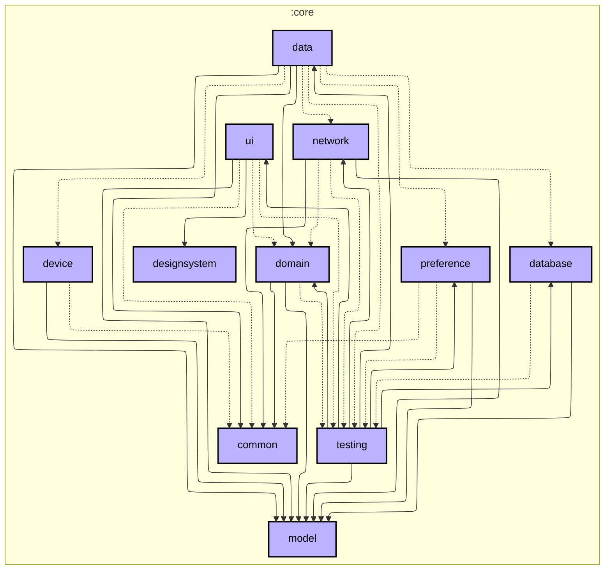
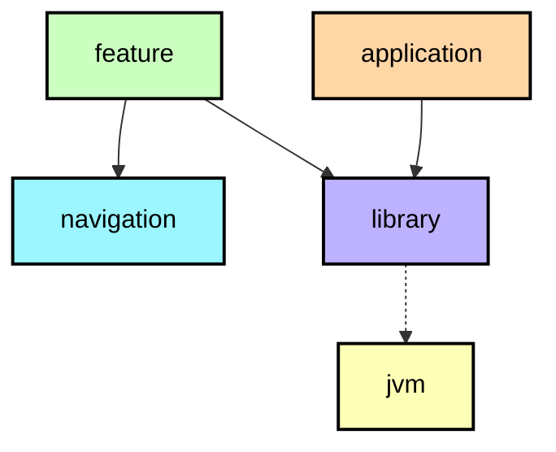

# `:core:domain`

## Qué hay aquí

La lógica de los datos del bus: **reglas puras** y **casos de uso**. No sabe de Android, de Compose
ni de pantallas; sólo de líneas, paradas, viajes y horas.

| Paquete | Qué contiene |
|---|---|
| `usecase/` | los **casos de uso**: la puerta del dominio. Cada uno pregunta algo ("dame las paradas de esta línea", "dame el bus que sigue el usuario") y devuelve el dato ya calculado. |
| `trip/` | las **reglas del viaje**: qué sentido va un bus, qué hora tiene cada parada, qué viaje es el que sigue el usuario, cuándo el feed está viejo, cómo se une la flota con el horario. |
| `geo/` | las **reglas de posición**: qué paradas hay cerca, a qué distancia están, por dónde va el bus. |
| `scan/` | la regla de **reconocer una parada** en un texto (el código QR). |
| `repository/` | los **contratos** de lo que el dominio necesita del exterior (catálogo, vehículos, horarios, favoritos, ajustes…). Los implementa `core:data`. |
| `di/` | el módulo de Koin del dominio. |
| (raíz) | `DomainConstants` (las tolerancias y plazos que usan varias reglas) y los `Repository` de contrato. |

## La regla de oro

> Si sólo depende de modelos de dominio y se puede testear sin falsificar una fuente, es dominio.

Por eso las reglas viven en `trip/` y `geo/` (funciones puras, con sus tests en `commonTest`) y no
en las pantallas: una pantalla no decide a qué hora pasa un bus.

## Module dependency graph

<!--region graph-->

📋 Graph legend

<!--endregion-->
