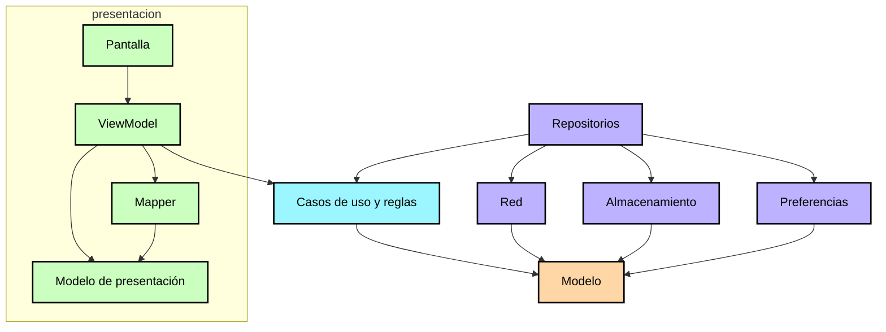

[English](ArchitectureLearningJourney.md) · **Español**

# Guía de arquitectura

Esta guía explica cómo se organiza el código dentro de los módulos, de qué otras capas puede depender
y cómo encajan los source sets de Kotlin Multiplatform. Sigue la
[guía oficial de arquitectura](https://developer.android.com/topic/architecture). Para saber cómo se
reparte el proyecto en módulos, consulta la [guía de modularización](ModularizationLearningJourney.es.md).

## Capas

Las flechas indican qué módulos dependen de otros. Los límites entre módulos imponen esa dirección:
`core:model` no depende de otros módulos del proyecto; `core:domain` depende de `core:model`; y
`core:data` depende de ambos. Cada funcionalidad puede depender de los módulos de `core` que necesite,
pero no de otra funcionalidad.

### `core:model`

Tipos de Kotlin a secas: `Stop`, `DepartureTime`, `BusLocation`, `Route`, `TrackedTrip`. Sin nada de
ningún framework. Al ser la base del grafo, todo puede depender de él sin crear un ciclo.

### `core:domain`

Las reglas del servicio que no deben vivir en una pantalla: cuándo se da por terminado un viaje, qué
dirección lleva el bus que sigues, qué hora le toca a cada parada o en qué punto del trayecto está tu
parada.

Estas reglas están aquí por dos motivos. Primero, describen el servicio, no la presentación: una
pantalla no debería tener que saber cuándo termina un viaje para poder mostrarlo. Segundo, como son
funciones puras, se pueden probar una vez y reutilizar en todas las plataformas, en vez de repetir la
comprobación en tests de interfaz para cada una.

### `core:data`

Es la única puerta de acceso a los datos. El dominio solicita lo que necesita sin saber si viene de
la red, de la base de datos o de las preferencias. Los repositorios deciden **de dónde** sale cada
cosa, cuándo se actualiza y qué se guarda.

Aquí se traduce lo que llega de fuera, ya sea un JSON o una fila de la base de datos, a los modelos de
dominio que usa el resto de la app.

### `core:network`, `core:database`, `core:preference`

Estos módulos podrían formar parte de `core:data`, pero mantenerlos separados permite que cada
funcionalidad incluya sólo los servicios que utiliza. Por ejemplo, una pantalla que sólo consulta el
tema de la app no debería tener que incluir el cliente de red.

Los datos externos se quedan en estos módulos. Al resto de la app sólo llegan modelos de dominio, no
respuestas JSON ni filas de la base de datos.

## La capa de interfaz

El código de interfaz se reparte entre dos módulos. `core:designsystem` proporciona el tema y los
componentes básicos. `core:ui` contiene modelos de presentación compartidos, sus mappers y componentes
que se usan en varias pantallas, como el mapa. Los componentes exclusivos de una funcionalidad se
quedan en su propio módulo.

Dentro de una funcionalidad, todas repiten la misma anatomía, y eso es lo que hace que una pantalla se
pueda leer de un vistazo:

| Parte | Contiene | No debe |
|---|---|---|
| `<Feature>Screen.kt` | Sólo composición: pinta el estado que recibe y envía eventos | Aplicar reglas de dominio, mapear ni formatear |
| `<Feature>ViewModel.kt` | Un `UiState` como `StateFlow`, montado con `stateInViewModel`, más los efectos | Arrancar trabajo en `init` ni exponer modelos de dominio |
| `model/` | El `…DisplayModel`: exactamente lo que se pinta, ya formateado | Llevar nada que la pantalla no pinte |
| `mapper/` | Funciones puras de modelo de dominio a ese modelo de presentación | Tocar la plataforma o el view model |
| `component/` | Las piezas con las que se construye la pantalla | Llegar al dominio directamente |
| `api/` | El contrato de destino que pueden usar otros módulos | Dejar salir tipos de la implementación |
| `di/` | Cómo se construye cada pieza de esta funcionalidad | — |

El view model prepara los datos; la pantalla sólo los muestra. Un `…DisplayModel` contiene valores
listos para usar, como textos, colores y booleanos, no objetos de dominio como `Stop` o
`DepartureTime`.

Esta separación permite probar el mapeo en `commonTest` para todas las plataformas, sin necesidad de
un test de interfaz, y mantiene las reglas de negocio fuera de la pantalla.

Cada view model expone un único `UiState` inmutable mediante un `StateFlow`, creado con
`stateInViewModel(viewModel, initialValue)`. El flujo de origen usa `WhileSubscribed`, así que deja de
recopilar datos cuando la pantalla no está visible. Los efectos puntuales, como los avisos y la
navegación, se mantienen separados del estado de la interfaz. El view model no inicia este trabajo en
`init`: responde a acciones de la pantalla o del usuario.

## Inyección de dependencias

La inyección de dependencias se comprueba al compilar. Cada módulo declara en `di/` qué proporciona y
qué necesita cada componente. El build genera el grafo de dependencias y el compilador lo verifica
antes de ejecutar la app. Si falta una dependencia, el build falla; no se espera a que aparezca un
error al abrir la primera pantalla.

## Navegación

Cada funcionalidad declara sus destinos como claves serializables en `api/`. El shell muestra una
pila de navegación guardada que contiene esas claves. Guardar la pila conserva el destino actual ante
cambios de configuración y el cierre del proceso. Otros módulos pueden navegar a una funcionalidad
usando su clave, sin depender de su implementación.

## Multiplataforma

Los cuatro targets son `android`, `jvm`, `iosArm64`/`iosSimulatorArm64` y `wasmJs`. La plantilla de
jerarquía por defecto da `commonMain` y `commonTest` para el código compartido, y los source sets de
plataforma sólo para lo que de verdad cambia:

* **Android** — la actividad, el manifiesto, los recursos, la cámara y la ubicación.
* **iOS** — el framework estático que enlaza el proyecto de Xcode, y las implementaciones de
  plataforma de las preferencias, la ubicación y el mapa.
* **JVM** — la ventana de escritorio y el mapa en canvas.
* **wasmJs** — el punto de entrada del navegador y el mapa web.

El código de `commonMain` debe compilar para todos los targets, así que no puede usar APIs exclusivas
de la JVM. Por ejemplo, los cálculos de horarios, la proyección de tiles y los helpers de
identificadores viven en source sets que sí pueden usar las APIs de JVM que necesitan.

Dónde se nota cada plataforma:

| | Android | iOS | Escritorio | Web |
|---|---|---|---|---|
| Mapa | MapLibre | MapLibre | canvas propio | MapLibre |
| Escáner de paradas | ML Kit con CameraX | Vision | no disponible | no disponible |
| Ubicación | APIs de Android | CoreLocation | no disponible | `navigator.geolocation` |
| Preferencias | un fichero | un fichero | un fichero | `localStorage` |

Cada fila se implementa mediante `expect`/`actual`, no con comprobaciones de plataforma dispersas por
el código.

## Tests

El [README](../README.es.md#tests) explica la estrategia general, los comandos para cada plataforma y
por qué se usan fakes. Esta sección se centra en cómo se distribuyen los tests entre los source sets.

Los tests viven junto al código que comprueban: el comportamiento compartido se prueba en
`commonTest`, mientras que los tests que necesitan APIs de la JVM —por ejemplo, los de integración que
usan los repositorios reales y un backend simulado— van en `jvmTest`.

Tres cosas no corren en todas partes. Los tests de `commonTest` de `shared` no pasan por el host de
Android porque ese módulo es el único que declara `withHostTest`. Los del simulador de iOS necesitan
un Mac con Apple Silicon. Y las pruebas `Live*` sólo se ejecutan con `LIVE_API=1`, así que el build
normal nunca depende de la red.

## Fuentes

* [Guía de arquitectura de apps](https://developer.android.com/topic/architecture) — el reparto en
  capas y la guía de la capa de interfaz que sigue este proyecto.
* [Capa de interfaz](https://developer.android.com/topic/architecture/ui-layer) — flujo de datos en
  una dirección, contenedores de estado y por qué el estado se expone como un único objeto inmutable.
* [Capa de dominio](https://developer.android.com/topic/architecture/domain-layer) — cuándo merece la
  pena un caso de uso, que aquí es siempre que una regla deba poder probarse sin interfaz.
* [Capa de datos](https://developer.android.com/topic/architecture/data-layer) — los repositorios
  como única fuente de verdad de una pantalla.
* [Now in Android](https://github.com/android/nowinandroid) y su
  [Architecture learning journey](https://github.com/android/nowinandroid/blob/main/docs/ArchitectureLearningJourney.md)
  — la referencia sobre la que está modelado este documento.
* [Tests en Kotlin Multiplatform](https://kotlinlang.org/docs/multiplatform-run-tests.html) — cómo
  corre `commonTest` en cada target.
* [Compose Multiplatform](https://www.jetbrains.com/compose-multiplatform/) — el runtime de interfaz
  compartido y el `expect`/`actual` que usa el mapa.
