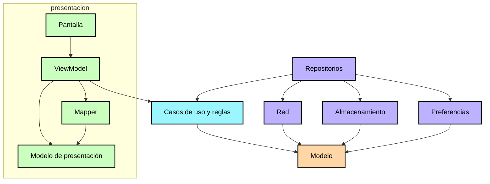

[English](ArchitectureLearningJourney.md) · **Español**

# Guía de arquitectura

Aquí se explica cómo está organizado el código dentro de los módulos, qué puede saber cada capa y
cómo encajan los source sets de multiplataforma. El razonamiento sigue la
[guía oficial de arquitectura](https://developer.android.com/topic/architecture); el reparto en
módulos está en la [guía de modularización](ModularizationLearningJourney.es.md).

## Capas

Las flechas van en la dirección de las dependencias, y esa dirección la imponen los módulos:
`core:model` no sabe nada, `core:domain` sabe de `core:model`, `core:data` sabe de los dos, y una
funcionalidad sabe lo que necesita de `core` pero nada de otra funcionalidad.

### `core:model`

Tipos de Kotlin a secas: `Stop`, `DepartureTime`, `BusLocation`, `Route`, `TrackedTrip`. Sin nada de
ningún framework. Al ser la base del grafo, todo puede depender de él sin crear un ciclo.

### `core:domain`

Las reglas del servicio que no deben vivir en una pantalla: cuándo se da por terminado un viaje, qué
dirección lleva el bus que sigues, qué hora le toca a cada parada o en qué punto del trayecto está tu
parada.

Están aquí por dos motivos. Uno, son decisiones de negocio, no de presentación: la pantalla no debería
tener que saber cuándo un viaje ha terminado para poder pintarlo. Y dos, al ser funciones puras se
prueban una vez y valen en todas las plataformas, en lugar de repetir la misma comprobación en un test
de interfaz de cada una.

### `core:data`

Es la única puerta a los datos. El dominio le pide lo que necesita y no sabe si viene de la red, de
la base de datos o de las preferencias; el repositorio decide **de dónde** sale cada cosa, cuándo se
refresca y qué se guarda.

Aquí se traduce lo que llega de fuera, ya sea un JSON o una fila de la base de datos, a los modelos de
dominio que usa el resto de la app.

### `core:network`, `core:database`, `core:preference`

Los tres podrían vivir dentro de `core:data`. Están fuera para que cada funcionalidad cargue sólo lo
que usa. Si el acceso al servicio estuviera en `core:data`, una pantalla que sólo lee el tema de la
app acabaría cargando también el cliente del servicio, aunque no lo use.

Y lo que viene de fuera se queda dentro. Hacia arriba sólo llegan modelos de dominio: nunca un JSON ni
una fila de una tabla.

## La capa de interfaz

Las pantallas no son las únicas que dibujan. `core:designsystem` pone el tema y las piezas básicas;
`core:ui` pone los modelos de presentación compartidos, sus mappers y los componentes que aparecen en
más de una pantalla, como el mapa. Todo lo que es de una sola funcionalidad se queda en esa
funcionalidad.

Dentro de una funcionalidad, todas repiten la misma anatomía, y eso es lo que hace que una pantalla se
pueda leer de un vistazo:

| Parte | Contiene | No debe |
|---|---|---|
| `<Feature>Screen.kt` | Sólo composición: pinta el estado que recibe y envía eventos | Aplicar reglas de dominio, mapear ni formatear |
| `<Feature>ViewModel.kt` | Un `UiState` como `StateFlow`, montado con `stateInViewModel`, más los efectos | Arrancar trabajo en `init` ni exponer modelos de dominio |
| `model/` | El `…DisplayModel`: exactamente lo que se pinta, ya formateado | Llevar nada que la pantalla no pinte |
| `mapper/` | Funciones puras de modelo de dominio a ese modelo de presentación | Tocar la plataforma o el view model |
| `component/` | Las piezas con las que se construye la pantalla | Llegar al dominio directamente |
| `api/` | El contrato de destino que pueden usar otros módulos | Dejar salir tipos de la implementación |
| `di/` | Cómo se construye cada pieza de esta funcionalidad | — |

El view model traduce; la pantalla sólo pinta. Un `…DisplayModel` lleva textos, colores y booleanos ya
resueltos, nunca un `Stop` ni un `DepartureTime`.

De ahí salen dos ventajas. El mapeo se prueba en `commonTest`, en todas las plataformas, sin un test de
interfaz.

El estado es un único `UiState` inmutable emitido desde un solo `StateFlow`, construido con
`stateInViewModel(viewModel, initialValue)`, que comparte el flujo de arriba con `WhileSubscribed`
para que una pantalla que no se ve no siga pidiendo datos. Los efectos que no son estado (avisos,
navegación) van aparte, y ninguno se arranca en `init`: el view model sólo reacciona a algo que hace
la pantalla o el usuario.

## Inyección de dependencias

Se resuelve al compilar. Cada módulo declara en `di/` qué construye y con qué, el grafo se genera en
el build y lo comprueba el compilador, no el arranque de la app. Así no hay un localizador resuelto por
reflexión en el camino caliente, y una dependencia que falta es un error de compilación en vez de un
fallo en la primera pantalla.

## Navegación

Los destinos son claves serializables que cada funcionalidad declara en su `api/`. La pila es una
lista de esas claves que se guarda, y el shell la pinta. Como se serializa y se recuerda, el destino
actual sobrevive a los cambios de configuración y a la muerte del proceso, y cualquier módulo puede
abrir una funcionalidad conociendo sólo su clave.

## Multiplataforma

Los cuatro targets son `android`, `jvm`, `iosArm64`/`iosSimulatorArm64` y `wasmJs`. La plantilla de
jerarquía por defecto da `commonMain` y `commonTest` para el código compartido, y los source sets de
plataforma sólo para lo que de verdad cambia:

* **Android** — la actividad, el manifiesto, los recursos, la cámara y la ubicación.
* **iOS** — el framework estático que enlaza el proyecto de Xcode, y las implementaciones de
  plataforma de las preferencias, la ubicación y el mapa.
* **JVM** — la ventana de escritorio y el mapa en canvas.
* **wasmJs** — el punto de entrada del navegador y el mapa web.

`commonMain` sólo lleva código que compila para todos los targets.

Dónde se nota la plataforma:

| | Android | iOS | Escritorio | Web |
|---|---|---|---|---|
| Mapa | MapLibre | MapLibre | canvas propio | MapLibre |
| Escáner de paradas | ML Kit con CameraX | Vision | no disponible | no disponible |
| Ubicación | APIs de Android | CoreLocation | no disponible | `navigator.geolocation` |
| Preferencias | un fichero | un fichero | un fichero | `localStorage` |

Cada fila es un `expect`/`actual`

## Tests

La estrategia, los comandos de cada plataforma y el porqué de los fakes están en el
[README](../README.es.md#tests). Aquí sólo lo que depende de los source sets.

Los tests van junto al código que prueban: `commonTest` para lo que es igual en todas las plataformas
y `jvmTest` para lo que necesita la JVM, como las pruebas que montan los repositorios reales contra el
backend simulado.

Tres cosas no corren en todas partes. Los tests de `commonTest` de `shared` no pasan por el host de
Android porque ese módulo es el único que declara `withHostTest`. Los del simulador de iOS necesitan
un Mac con Apple Silicon. Y las pruebas `Live*` sólo se ejecutan con `LIVE_API=1`, así que el build
normal nunca depende de la red.

## Fuentes

* [Guía de arquitectura de apps](https://developer.android.com/topic/architecture) — el reparto en
  capas y la guía de la capa de interfaz que sigue este proyecto.
* [Capa de interfaz](https://developer.android.com/topic/architecture/ui-layer) — flujo de datos en
  una dirección, contenedores de estado y por qué el estado se expone como un único objeto inmutable.
* [Capa de dominio](https://developer.android.com/topic/architecture/domain-layer) — cuándo merece la
  pena un caso de uso, que aquí es siempre que una regla deba poder probarse sin interfaz.
* [Capa de datos](https://developer.android.com/topic/architecture/data-layer) — los repositorios
  como única fuente de verdad de una pantalla.
* [Now in Android](https://github.com/android/nowinandroid) y su
  [Architecture learning journey](https://github.com/android/nowinandroid/blob/main/docs/ArchitectureLearningJourney.md)
  — la referencia sobre la que está modelado este documento.
* [Tests en Kotlin Multiplatform](https://kotlinlang.org/docs/multiplatform-run-tests.html) — cómo
  corre `commonTest` en cada target.
* [Compose Multiplatform](https://www.jetbrains.com/compose-multiplatform/) — el runtime de interfaz
  compartido y el `expect`/`actual` que usa el mapa.
