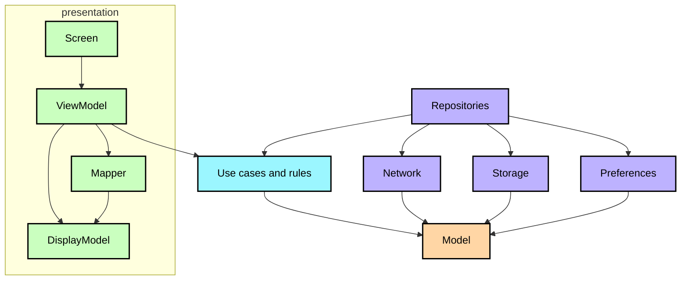

**English** · [Español](ArchitectureLearningJourney.es.md)

# Architecture guide

This guide explains how code is organised inside the modules, what each layer may depend on, and how
Kotlin Multiplatform source sets fit together. It follows the
[official architecture guidance](https://developer.android.com/topic/architecture). For how the
project is split into modules, see the [modularization guide](ModularizationLearningJourney.md).

## Layers

The arrows show which modules depend on which others. Module boundaries enforce this direction:
`core:model` has no project dependencies; `core:domain` depends on `core:model`; and `core:data`
depends on both. A feature may depend on the `core` modules it needs, but not on another feature.

### `core:model`

Plain Kotlin types: `Stop`, `DepartureTime`, `BusLocation`, `Route`, `TrackedTrip`. Nothing from any
framework. Because it is the bottom of the graph, everything can depend on it without creating a
cycle.

### `core:domain`

The rules of the service that should not live in a screen: when a trip is over, which direction the bus
you follow is running, what time each stop is due, or how far along its way your stop is.

These rules belong here for two reasons. First, they describe the service, not the presentation: a
screen should not need to know when a trip has ended just to display it. Second, because the rules are
pure functions, they can be tested once and reused on every platform instead of being rechecked in UI
tests for each one.

### `core:data`

It is the only door to the data. The domain requests what it needs without knowing whether it comes
from the network, database or preferences. Repositories choose *where* the data comes from, when to
refresh it and what to store.

Whatever arrives from outside, a JSON payload or a table row, is translated here into the domain models
the rest of the app uses.

### `core:network`, `core:database`, `core:preference`

These modules could be part of `core:data`, but keeping them separate lets each feature include only
the services it uses. For example, a screen that only reads the app theme should not need to include
the network client.

Data from external systems stays in these modules. Only domain models pass to the rest of the app—not
raw JSON payloads or database rows.

## The UI layer

UI code is split between two modules. `core:designsystem` provides the theme and basic components.
`core:ui` contains shared display models, their mappers and components used by multiple screens, such
as the map. Components used by only one feature stay in that feature's module.

Inside a feature, they all repeat the same anatomy, which is what makes a screen predictable to read:

| Part | Holds | Must not |
|---|---|---|
| `<Feature>Screen.kt` | Composition only: it renders the state it is handed and sends events | Apply a domain rule, map, or format |
| `<Feature>ViewModel.kt` | One `UiState` `StateFlow` built with `stateInViewModel`, plus effects | Start work in `init`, expose domain models |
| `model/` | The `…DisplayModel`: exactly what the screen paints, already formatted | Carry anything the screen does not draw |
| `mapper/` | Pure functions from domain models to that display model | Touch the platform or the view model |
| `component/` | The pieces the screen is made of | Reach the domain directly |
| `api/` | The destination contract other modules may use | Leak implementation types |
| `di/` | How each piece of this feature is built | — |

The view model prepares the data; the screen only displays it. A `…DisplayModel` contains ready-to-use
values such as strings, colours and booleans—not domain objects such as `Stop` or `DepartureTime`.

This separation lets `commonTest` verify the mapping on every platform without a UI test. It also
keeps business rules out of the screen code.

Each view model exposes one immutable `UiState` through a `StateFlow`, created with
`stateInViewModel(viewModel, initialValue)`. The upstream flow uses `WhileSubscribed`, so it stops
collecting while its screen is not visible. One-off effects such as snackbars and navigation are kept
separate from UI state. View models do not start this work in `init`; they respond to screen or user
actions.

## Dependency injection

Dependency injection is checked at compile time. Each module declares in `di/` what it provides and
what those components require. The build generates the dependency graph and the compiler checks it
before the app runs. A missing dependency therefore fails the build, rather than causing an error when
a screen first opens.

## Navigation

Each feature declares its destinations as serializable keys in `api/`. The app shell renders a saved
back stack containing those keys. Saving the stack preserves the current destination across
configuration changes and process death. Other modules can navigate to a feature using its key,
without depending on its implementation.

## Multiplatform

The four targets are `android`, `jvm`, `iosArm64`/`iosSimulatorArm64` and `wasmJs`. The default
hierarchy template gives `commonMain` and `commonTest` for shared code, and the platform source sets
only for what genuinely differs:

* **Android** — the activity, the manifest, the resources, camera and location.
* **iOS** — the static framework the Xcode project links, and the platform implementations of
  preferences, location and the map.
* **JVM** — the desktop window and the canvas map.
* **wasmJs** — the browser entry point and the web map.

Code in `commonMain` must compile for every target, so JVM-only APIs cannot be used there. For
example, the timetable calculations, tile projection and identifier helpers live in source sets that
can use the JVM APIs they need.

Where the platform shows through:

| | Android | iOS | Desktop | Web |
|---|---|---|---|---|
| Map | MapLibre | MapLibre | canvas of its own | MapLibre |
| Stop scanner | ML Kit with CameraX | Vision | not available | not available |
| Location | Android APIs | CoreLocation | not available | `navigator.geolocation` |
| Preferences | a file | a file | a file | `localStorage` |

Each row is an `expect`/`actual`, not an `if (isAndroid)` scattered through the code.

## Testing

The [README](../README.md#tests) explains the overall test strategy, platform-specific commands and
why the project uses fakes. This section focuses on how tests are split across source sets.

Tests live alongside the code they cover: shared behavior is tested in `commonTest`, while tests that
need JVM APIs—such as integration tests using the real repositories and a stubbed backend—live in
`jvmTest`.

Three things do not run everywhere. The `shared` `commonTest` ones do not go through the Android host,
because that module is the only one declaring `withHostTest`. The iOS simulator ones need an Apple
Silicon Mac. And the `Live*` probes only run with `LIVE_API=1`, so the normal build never depends on
the network.

## Sources

* [Guide to app architecture](https://developer.android.com/topic/architecture) — the layer split and
  the UI layer guidance this project follows.
* [UI layer](https://developer.android.com/topic/architecture/ui-layer) — unidirectional data flow,
  state holders and why state is exposed as a single immutable object.
* [Domain layer](https://developer.android.com/topic/architecture/domain-layer) — when a use case is
  worth having, which here is whenever a rule must be testable without a UI.
* [Data layer](https://developer.android.com/topic/architecture/data-layer) — repositories as the
  single source of truth for a screen.
* [Now in Android](https://github.com/android/nowinandroid) and its
  [Architecture learning journey](https://github.com/android/nowinandroid/blob/main/docs/ArchitectureLearningJourney.md)
  — the reference this document is modelled on.
* [Testing on Kotlin Multiplatform](https://kotlinlang.org/docs/multiplatform-run-tests.html) — how
  `commonTest` runs on every target.
* [Compose Multiplatform](https://www.jetbrains.com/compose-multiplatform/) — the shared UI runtime
  and the `expect`/`actual` used by the map.
