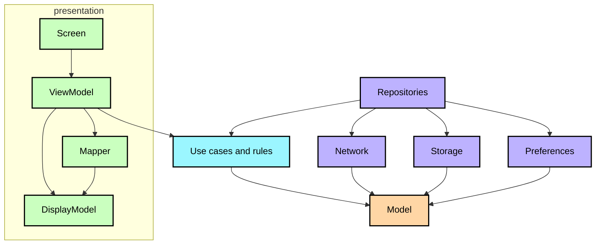

**English** · [Español](ArchitectureLearningJourney.es.md)

# Architecture guide

Here you will learn how the code inside the modules is organised, what each
layer is allowed to know, and how the multiplatform source sets fit into that. The reasoning follows
[the official architecture guidance](https://developer.android.com/topic/architecture); the module
split is described in the [modularization guide](ModularizationLearningJourney.md).

## Layers

The direction of the arrows is the direction of the dependencies, and it is enforced by the module
boundaries: `core:model` knows nothing, `core:domain` knows `core:model`, `core:data` knows both, and
a feature knows whatever it needs from `core` but nothing from another feature.

### `core:model`

Plain Kotlin types: `Stop`, `DepartureTime`, `BusLocation`, `Route`, `TrackedTrip`. Nothing from any
framework. Because it is the bottom of the graph, everything can depend on it without creating a
cycle.

### `core:domain`

The rules of the service that should not live in a screen: when a trip is over, which direction the bus
you follow is running, what time each stop is due, or how far along its way your stop is.

They live here for two reasons. One, they are business decisions, not presentation ones: a screen
should not have to know that a trip has ended in order to paint it. And two, being pure functions they
are tested once and hold on every platform, instead of repeating the same check in a UI test for each
one.

### `core:data`

It is the only door to the data. The domain asks for what it needs and does not know whether it comes
from the network, the database or the preferences; the repository decides *where* each thing comes
from, when it is refreshed and what gets stored.

Whatever arrives from outside, a JSON payload or a table row, is translated here into the domain models
the rest of the app uses.

### `core:network`, `core:database`, `core:preference`

All three could live inside `core:data`. They are outside so that each feature carries only what it
uses. If service access lived in `core:data`, a screen that only reads the app theme would end up
loading the service client too, even though it does not use it.

And whatever comes from outside stays inside. Only domain models travel up: never a JSON payload nor a
table row.

## The UI layer

Screens are not the only thing that draws. `core:designsystem` provides the theme and the basic
pieces; `core:ui` provides the shared display models, their mappers and the components that appear on
more than one screen, such as the map. Anything belonging to a single feature stays in that feature.

Inside a feature, they all repeat the same anatomy, which is what makes a screen predictable to read:

| Part | Holds | Must not |
|---|---|---|
| `<Feature>Screen.kt` | Composition only: it renders the state it is handed and sends events | Apply a domain rule, map, or format |
| `<Feature>ViewModel.kt` | One `UiState` `StateFlow` built with `stateInViewModel`, plus effects | Start work in `init`, expose domain models |
| `model/` | The `…DisplayModel`: exactly what the screen paints, already formatted | Carry anything the screen does not draw |
| `mapper/` | Pure functions from domain models to that display model | Touch the platform or the view model |
| `component/` | The pieces the screen is made of | Reach the domain directly |
| `api/` | The destination contract other modules may use | Leak implementation types |
| `di/` | How each piece of this feature is built | — |

The view model translates; the screen only paints. A `…DisplayModel` carries strings, colours and
booleans already resolved, never a `Stop` or a `DepartureTime`.

Two things follow. The mapping is tested in `commonTest` on every platform, without a UI test. And the
screen is left with no room to start collecting business rules.

The state is a single immutable `UiState` emitted from one `StateFlow`, produced with
`stateInViewModel(viewModel, initialValue)`, which shares the upstream flow with
`WhileSubscribed` so a screen that is not visible does not keep polling. Effects that are not state
(snackbars, navigation) are separate, and none of them start in `init`: a view model only reacts to
something the screen or the user does.

## Dependency injection

It is resolved at compile time. Each module declares in `di/` what it builds and with what, the graph
is generated during the build and checked by the compiler, not when the app starts. So there is no
service locator answered through reflection on a hot path, and a missing dependency is a build error
instead of a failure on the first screen.

## Navigation

The destinations are serializable keys each feature declares in its `api/`. The back stack is a list
of those keys that gets saved, and the shell renders it. Because it is serialized and remembered, the
current destination survives configuration changes and process death, and any module can open a
feature knowing only its key.

## Multiplatform

The four targets are `android`, `jvm`, `iosArm64`/`iosSimulatorArm64` and `wasmJs`. The default
hierarchy template gives `commonMain` and `commonTest` for shared code, and the platform source sets
only for what genuinely differs:

* **Android** — the activity, the manifest, the resources, camera and location.
* **iOS** — the static framework the Xcode project links, and the platform implementations of
  preferences, location and the map.
* **JVM** — the desktop window and the canvas map.
* **wasmJs** — the browser entry point and the web map.

The rule is that anything JVM-specific stays out of `commonMain`: the timetable maths, the tile
projection and the identifier helpers live in the platform source sets that use them, and `commonMain`
only holds code that compiles for every target.

Where the platform shows through:

| | Android | iOS | Desktop | Web |
|---|---|---|---|---|
| Map | MapLibre | MapLibre | canvas of its own | MapLibre |
| Stop scanner | ML Kit with CameraX | Vision | not available | not available |
| Location | Android APIs | CoreLocation | not available | `navigator.geolocation` |
| Preferences | a file | a file | a file | `localStorage` |

Each row is an `expect`/`actual`, not an `if (isAndroid)` scattered through the code.

## Testing

The strategy, the commands per platform and why the fakes are used live in the
[README](../README.md#tests). This section only covers what depends on the source sets.

Tests sit next to the code they check: `commonTest` for what is the same on every platform and
`jvmTest` for what needs the JVM, such as the ones wiring the real repositories against the stubbed
backend.

Three things do not run everywhere. The `shared` `commonTest` ones do not go through the Android host,
because that module is the only one declaring `withHostTest`. The iOS simulator ones need an Apple
Silicon Mac. And the `Live*` probes only run with `LIVE_API=1`, so the normal build never depends on
the network.

## Sources

* [Guide to app architecture](https://developer.android.com/topic/architecture) — the layer split and
  the UI layer guidance this project follows.
* [UI layer](https://developer.android.com/topic/architecture/ui-layer) — unidirectional data flow,
  state holders and why state is exposed as a single immutable object.
* [Domain layer](https://developer.android.com/topic/architecture/domain-layer) — when a use case is
  worth having, which here is whenever a rule must be testable without a UI.
* [Data layer](https://developer.android.com/topic/architecture/data-layer) — repositories as the
  single source of truth for a screen.
* [Now in Android](https://github.com/android/nowinandroid) and its
  [Architecture learning journey](https://github.com/android/nowinandroid/blob/main/docs/ArchitectureLearningJourney.md)
  — the reference this document is modelled on.
* [Testing on Kotlin Multiplatform](https://kotlinlang.org/docs/multiplatform-run-tests.html) — how
  `commonTest` runs on every target.
* [Compose Multiplatform](https://www.jetbrains.com/compose-multiplatform/) — the shared UI runtime
  and the `expect`/`actual` used by the map.
