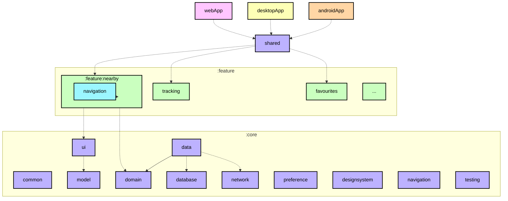
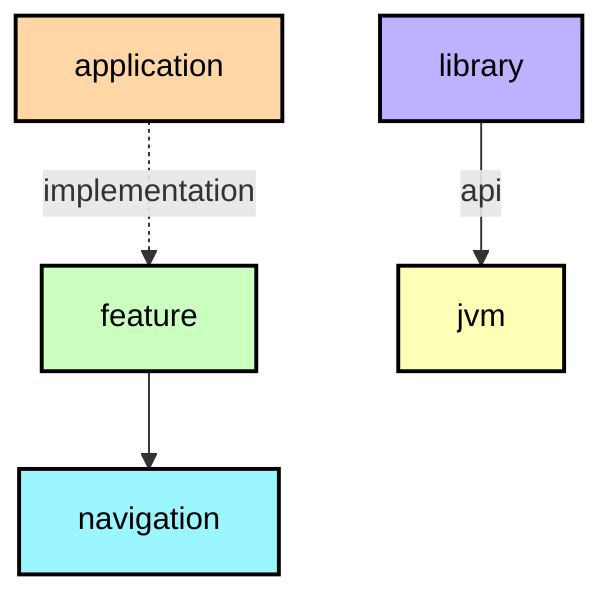

[English](ModularizationLearningJourney.md) · **Español**

# Guía de modularización

Aquí se explica cómo se reparte Logroño Bus en módulos de Gradle y cómo el build impide que esa
estructura se degrade. Es la guía de cómo se relacionan los módulos; cómo está escrito el código
**dentro** de cada uno está en la [guía de arquitectura](ArchitectureLearningJourney.es.md). Para la
teoría de la modularización, está la
[guía oficial](https://developer.android.com/topic/modularization).

**IMPORTANTE:** cada módulo tiene su grafo de dependencias en su README
([ejemplo con el módulo `shared`](../shared/README.md)), que ayuda a entender la estructura completa
del proyecto.

## Tipos de módulo



<details><summary>Leyenda del grafo</summary>



Una flecha continua es una dependencia `api` y una punteada es `implementation`. El color del nodo es
el plugin de convención que aplica el módulo, no el plugin de Android que lleva debajo. Los mismos
colores se usan en todos los READMEs generados.

</details>

**Consejo:** un grafo de módulos (como el de arriba) viene bien al planificar una modularización,
porque deja ver las dependencias entre módulos. Por eso cada módulo lleva el suyo, generado desde
Gradle en vez de dibujado a mano.

El proyecto tiene estos tipos de módulo:

### Los módulos de aplicación

`androidApp`, `desktopApp` y `webApp` son los tres puntos de entrada. Sólo llevan lo que es de una
plataforma: la actividad de Android, la configuración de firma y el manifiesto; la aplicación de
escritorio y su empaquetado; el punto de entrada web y la salida de webpack. Dependen de `shared` y de
los módulos de `core` que necesitan, y nadie depende de ellos.

`shared` es el anfitrión de la interfaz: monta el shell, es el dueño del estado de navegación de la
app y conecta las funcionalidades entre sí. Depende de todos los módulos de `core` y de todas las
funcionalidades, y es el único módulo que conoce a todas.

### Módulos de funcionalidad

Cada funcionalidad son dos módulos de Gradle:

* `feature:<nombre>` — la pantalla, su view model, el modelo de presentación y su mapper, cómo se
  construye cada pieza y los componentes de la pantalla.
* `feature:<nombre>:navigation` — sólo el contrato de destino: la clave que identifica la pantalla y
  la función que la pinta dentro del shell.

Ese reparto existe para que una funcionalidad pueda navegar a otra sin ver su implementación:
`feature:nearby` depende de `feature:stops:navigation`, nunca de `feature:stops`. El módulo de
navegación son tres líneas de configuración porque sólo lleva el contrato y su serialización.

Un módulo de funcionalidad no debe depender de otro módulo de funcionalidad. Si dos funcionalidades
necesitan lo mismo, eso va a un módulo de `core`.

### Módulos de `core`

Los módulos de `core` llevan el código que comparten las funcionalidades. Pueden depender de otros
módulos de `core`, nunca de una funcionalidad ni de una aplicación. Su orden es el de las capas:

| Módulo | Responsabilidad |
|---|---|
| `core:model` | Los modelos de dominio de los que habla la app (`Stop`, `DepartureTime`, `BusLocation`, `Route`, `TrackingView`). Sin tipos de ningún framework. |
| `core:domain` | Casos de uso y las reglas que no deben vivir en una pantalla: el fin del viaje, la dirección, los tiempos por parada, el estado de la parada que sigues. |
| `core:data` | Implementaciones de repositorio que juntan red, base de datos y preferencias en los flujos que consume el dominio. |
| `core:network` | Traduce lo que responde el servicio a modelos de dominio; sus tipos no salen de aquí. |
| `core:database` | Guarda el catálogo y las paradas que sigues, con migraciones explícitas y sin fallback destructivo. |
| `core:preference` | Guarda ajustes pequeños (tema, idioma, última línea) con lectura inmediata. |
| `core:common` | Utilidades pequeñas compartidas, sin capa propia. |
| `core:device` | Lo que depende del dispositivo (ubicación y compañía) detrás de un `expect`/`actual`. |
| `core:ui` | Los modelos de presentación que comparten las pantallas, sus mappers, los componentes compuestos y el mapa. |
| `core:designsystem` | Tema, tokens, tipografía, iconos y las primitivas que usa cada pantalla. |
| `core:navigation` | El shell que decide qué pantalla se ve y cómo se vuelve atrás. |
| `core:testing` | Fakes, builders y el `MainDispatcherRule`. |

### Módulos varios

`iosApp` no es un módulo de Gradle: es el proyecto de Xcode que enlaza el framework estático que
produce `shared` y arranca la interfaz de Compose.

## Plugins de convención

Casi todos los módulos comparten el mismo bloque `plugins { }`, los mismos targets, la misma regla de
`namespace` y casi el mismo stack de dependencias. En vez de copiar eso en cada `build.gradle.kts`, el
build aplica un **plugin de convención** de `build-logic`:

| Plugin | Qué aplica |
|---|---|
| `logronobus.kmp.library` | Kotlin Multiplatform + librería de Android, los cuatro targets (`jvm`, `iosArm64`, `iosSimulatorArm64`, `wasmJs`), el `namespace` a partir de la ruta del módulo, `compileSdk`/`minSdk` del catálogo de versiones, JVM 17 y la jerarquía por defecto |
| `logronobus.compose` | Compose Multiplatform y el compilador de Compose |
| `logronobus.koin` | KSP, el plugin del compilador de Koin y el cableado del código generado |
| `logronobus.serialization` | Serialización de Kotlin |
| `logronobus.kmp.navigation` | Librería + serialización + Navigation 3 |
| `logronobus.kmp.feature` | Librería + Compose + Koin + serialización + el stack de interfaz y el de test |
| `logronobus.spotless` | Spotless con ktlint (las reglas viven en `.editorconfig`) y la cabecera de licencia |

El resultado es que un módulo sólo declara lo suyo:

```kotlin
plugins {
    id("logronobus.kmp.feature")
}

kotlin {
    sourceSets {
        commonMain.dependencies {
            implementation(project(":core:domain"))
            implementation(project(":feature:stops:navigation"))
        }
    }
}
```

Dos decisiones que merece la pena nombrar:

* Los plugins son **plugins de convención basados en clases**: un `Plugin<Project>` por
  preocupación en `build-logic/convention`, cada uno registrado con su id en `gradlePlugin { }`. El
  código que comparten vive en funciones auxiliares al lado (`configureKotlinMultiplatform`, `libs`,
  `requiredLibrary`), así que ningún módulo lo repite.
* `build-logic` reutiliza el catálogo de versiones de la raíz
  (`versionCatalogs { create("libs") { from(files("../gradle/libs.versions.toml")) } }`), así que
  subir una versión es una sola edición y llega también a los plugins.

## Grafos de dependencias

Cada módulo tiene su `README.md` con un grafo, por ejemplo
[`:feature:nearby`](../feature/nearby/README.md). Los genera el plugin `logronobus.module-graph` de
`build-logic`, portado del mismo enfoque que usa Now in Android:

* `./gradlew graphDump` escribe los grafos en un directorio temporal.
* `./gradlew graphUpdate` reescribe el `README.md` de cada módulo, y lo crea si falta.

La tarea lee el grafo real de dependencias de Gradle y apunta, para cada arista, si viene de una
configuración `api` o `implementation`, que es lo que muestra el estilo de la flecha. Los nodos se
agrupan en subgrafos anidados por ruta y se colorean por plugin de convención, así que un grafo dice
de un vistazo si estás mirando una funcionalidad, un contrato de navegación, una librería de `core`,
una aplicación o un módulo JVM normal.

Como la entrada es el propio build, los grafos no pueden desviarse del código: no hay una lista de
módulos que mantener, y un módulo que deja de existir desaparece de todos los grafos en la siguiente
ejecución. La tarea forma parte del build, así que `graphUpdate` reutiliza la caché de configuración y una
ejecución sin cambios tarda segundos.

Lo que un grafo no hace es impedir nada. Si una funcionalidad depende de otra, el build compila igual;
la dependencia aparece en el grafo en la siguiente ejecución, y ahí se ve.

## Fuentes

La estrategia sigue la guía oficial y parte del trabajo de modularización que publicó el equipo de
Now in Android:

* [Guía de modularización de apps](https://developer.android.com/topic/modularization) — la teoría:
  para qué sirve un módulo y cómo repartir por funcionalidad y por capa.
* [Patrones de modularización](https://developer.android.com/topic/modularization/patterns) — los
  patrones que se aplican aquí: módulos de funcionalidad con contrato de navegación, `api` frente a
  `implementation`.
* [Modularization learning journey de Now in Android](https://github.com/android/nowinandroid/blob/main/docs/ModularizationLearningJourney.md)
  — la referencia sobre la que está modelado este documento, incluidos los grafos por módulo.
* [`build-logic` de Now in Android](https://github.com/android/nowinandroid/tree/main/build-logic) —
  el enfoque de plugins de convención y el generador de grafos del que se portó el de aquí.
* [Compartir lógica de build entre subproyectos](https://docs.gradle.org/current/userguide/sharing_build_logic_between_subprojects.html)
  — la guía de Gradle sobre plugins de convención.
* [Kotlin Multiplatform](https://kotlinlang.org/docs/multiplatform.html) — cómo funcionan los targets y
  los source sets, que es lo que configuran los plugins de convención.
