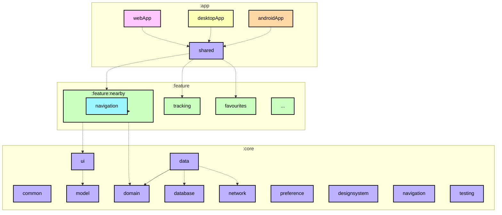
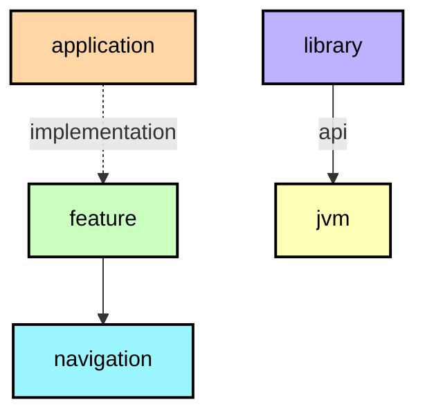

[English](ModularizationLearningJourney.md) · **Español**

# Guía de modularización

Esta guía explica cómo se divide Logroño Bus en módulos de Gradle y cómo el build ayuda a mantener
esa estructura coherente. Se centra en las dependencias entre módulos; para saber cómo se organiza el
código **dentro** de cada uno, consulta la [guía de arquitectura](ArchitectureLearningJourney.es.md).
Puedes consultar los [principios generales de modularización](https://developer.android.com/topic/modularization)
en la documentación oficial.

El README de cada módulo incluye su grafo de dependencias. Estos grafos ayudan a entender cómo encaja
el proyecto; aquí tienes como ejemplo el [grafo de `:app:shared`](../app/shared/README.md).

## Tipos de módulo



<details><summary>Leyenda del grafo</summary>



Una flecha continua representa una dependencia `api`; una punteada, una dependencia
`implementation`. El color del nodo indica el plugin de convención que aplica el módulo, no el plugin
de Android subyacente. Todos los README generados usan los mismos colores.

</details>

El grafo anterior muestra las dependencias entre módulos. El README de cada módulo incluye uno
generado desde Gradle, así los diagramas reflejan la configuración del build y no dependen de cambios
manuales.

El proyecto tiene estos tipos de módulo:

### Los módulos de aplicación

`:app:androidApp`, `:app:desktopApp` y `:app:webApp` son los puntos de entrada de cada plataforma.
Sus proyectos y el anfitrión de la interfaz compartida se agrupan en `app/`. Cada módulo de app
contiene la configuración necesaria para iniciar y empaquetar la app: la actividad, el manifiesto y
la firma en Android; la aplicación y el empaquetado de escritorio; o el punto de entrada web y la
salida de webpack. Dependen de `:app:shared` y de los módulos de `core` que necesitan. Ningún otro
módulo depende de estas aplicaciones.

`:app:shared` aloja la interfaz compartida. Monta el shell de la app, mantiene el estado de navegación
principal y conecta las funcionalidades. Depende de todos los módulos de `core` y de todas las
funcionalidades, por lo que es el único módulo que reúne la app completa.

`app/iosApp` está agrupado con estos proyectos, pero sigue siendo un proyecto de Xcode, no un módulo
Gradle. Enlaza el framework de iOS que produce `:app:shared`.

### Módulos de funcionalidad

Cada funcionalidad son dos módulos de Gradle:

* `feature:<nombre>` — la pantalla, su view model, el modelo de presentación y su mapper, cómo se
  construye cada pieza y los componentes de la pantalla.
* `feature:<nombre>:navigation` — sólo el contrato de destino: la clave que identifica la pantalla y
  la función que la pinta dentro del shell.

Esta separación permite que una funcionalidad navegue a otra sin depender de su implementación. Por
ejemplo, `feature:nearby` depende de `feature:stops:navigation`, no de `feature:stops`. El módulo de
navegación es pequeño porque sólo contiene el contrato del destino y su serialización.

Un módulo de funcionalidad no debe depender de otro módulo de funcionalidad. Si dos funcionalidades
necesitan lo mismo, eso va a un módulo de `core`.

### Módulos de `core`

Los módulos de `core` llevan el código que comparten las funcionalidades. Pueden depender de otros
módulos de `core`, nunca de una funcionalidad ni de una aplicación. Su orden es el de las capas:

| Módulo | Responsabilidad |
|---|---|
| `core:model` | Los modelos de dominio de los que habla la app (`Stop`, `DepartureTime`, `BusLocation`, `Route`, `TrackingView`). Sin tipos de ningún framework. |
| `core:domain` | Casos de uso y las reglas que no deben vivir en una pantalla: el fin del viaje, la dirección, los tiempos por parada, el estado de la parada que sigues. |
| `core:data` | Implementaciones de repositorio que juntan red, base de datos y preferencias en los flujos que consume el dominio. |
| `core:network` | Traduce lo que responde el servicio a modelos de dominio; sus tipos no salen de aquí. |
| `core:database` | Guarda el catálogo y las paradas que sigues, con migraciones explícitas y sin fallback destructivo. |
| `core:preference` | Guarda ajustes pequeños (tema, idioma, última línea) con lectura inmediata. |
| `core:common` | Utilidades pequeñas compartidas, sin capa propia. |
| `core:device` | Lo que depende del dispositivo (ubicación y compañía) detrás de un `expect`/`actual`. |
| `core:ui` | Los modelos de presentación que comparten las pantallas, sus mappers, los componentes compuestos y el mapa. |
| `core:designsystem` | Tema, tokens, tipografía, iconos y las primitivas que usa cada pantalla. |
| `core:navigation` | El shell que decide qué pantalla se ve y cómo se vuelve atrás. |
| `core:testing` | Fakes, builders y el `MainDispatcherRule`. |

### Módulos varios

`app/iosApp` no es un módulo de Gradle: es el proyecto de Xcode que enlaza el framework estático que
produce `:app:shared` y arranca la interfaz de Compose.

## Plugins de convención

La mayoría de los módulos usa los mismos plugins, targets, reglas de `namespace` y dependencias
básicas. Para no copiar esta configuración en cada `build.gradle.kts`, el build aplica un **plugin de
convención** de `build-logic`:

| Plugin | Qué aplica |
|---|---|
| `logronobus.kmp.library` | Kotlin Multiplatform + librería de Android, los cuatro targets (`jvm`, `iosArm64`, `iosSimulatorArm64`, `wasmJs`), el `namespace` a partir de la ruta del módulo, `compileSdk`/`minSdk` del catálogo de versiones, JVM 17 y la jerarquía por defecto |
| `logronobus.kmp.compose` | Librería + Compose Multiplatform + el compilador de Compose |
| `logronobus.android.application` | Aplicación Android + Compose + los niveles de SDK del catálogo de versiones |
| `logronobus.koin` | KSP, el plugin del compilador de Koin y el cableado del código generado |
| `logronobus.serialization` | Serialización de Kotlin |
| `logronobus.kmp.navigation` | Librería + serialización + Navigation 3 |
| `logronobus.kmp.feature` | Librería + Compose + Koin + serialización + el stack de interfaz y el de test |
| `logronobus.spotless` | Spotless con ktlint (las reglas viven en `.editorconfig`) y la cabecera de licencia |

El resultado es que un módulo sólo declara lo suyo:

```kotlin
plugins {
    id("logronobus.kmp.feature")
}

kotlin {
    sourceSets {
        commonMain.dependencies {
            implementation(project(":core:domain"))
            implementation(project(":feature:stops:navigation"))
        }
    }
}
```

Hay dos decisiones de implementación que conviene destacar:

* Los plugins de convención están **basados en clases**: cada responsabilidad tiene su propio
  `Plugin<Project>` en `build-logic/convention`, registrado con un id en `gradlePlugin { }`. La
  configuración compartida se mantiene en funciones auxiliares cercanas, como
  `configureKotlinMultiplatform`, `libs` y `requiredLibrary`, en vez de repetirse en cada módulo.
* `build-logic` utiliza el catálogo de versiones de la raíz
  (`versionCatalogs { create("libs") { from(files("../gradle/libs.versions.toml")) } }`). Así las
  versiones de dependencias, incluidas las que usan los plugins de convención, se mantienen en un
  único sitio.

## Grafos de dependencias

Cada módulo tiene su `README.md` con un grafo, por ejemplo
[`:feature:nearby`](../feature/nearby/README.md). Los genera el plugin `logronobus.module-graph` de
`build-logic`, portado del mismo enfoque que usa Now in Android:

* `./gradlew graphDump` escribe los grafos en un directorio temporal.
* `./gradlew graphUpdate` reescribe el `README.md` de cada módulo, y lo crea si falta.

La tarea lee el grafo real de dependencias de Gradle. Para cada relación indica si usa `api` o
`implementation`; el estilo de la flecha muestra cuál. Agrupa los nodos por ruta del módulo y los
colorea según el plugin de convención, para distinguir fácilmente funcionalidades, contratos de
navegación, módulos de `core`, aplicaciones y módulos JVM.

Como los grafos se generan a partir de la configuración del build, se mantienen sincronizados sin
necesidad de actualizar una lista de módulos por separado. Si se elimina un módulo, desaparecerá de
los grafos al volver a ejecutar la tarea. `graphUpdate` forma parte del build y usa la caché de
configuración, por lo que una ejecución sin cambios termina rápido.

Los grafos documentan las dependencias, pero no imponen las reglas de arquitectura. Por ejemplo,
Gradle seguirá compilando aunque una funcionalidad dependa de otra; esa relación aparecerá en el grafo
la próxima vez que se genere.

## Fuentes

La estrategia sigue la guía oficial y parte del trabajo de modularización que publicó el equipo de
Now in Android:

* [Guía de modularización de apps](https://developer.android.com/topic/modularization) — la teoría:
  para qué sirve un módulo y cómo repartir por funcionalidad y por capa.
* [Patrones de modularización](https://developer.android.com/topic/modularization/patterns) — los
  patrones que se aplican aquí: módulos de funcionalidad con contrato de navegación, `api` frente a
  `implementation`.
* [Modularization learning journey de Now in Android](https://github.com/android/nowinandroid/blob/main/docs/ModularizationLearningJourney.md)
  — la referencia sobre la que está modelado este documento, incluidos los grafos por módulo.
* [`build-logic` de Now in Android](https://github.com/android/nowinandroid/tree/main/build-logic) —
  el enfoque de plugins de convención y el generador de grafos del que se portó el de aquí.
* [Compartir lógica de build entre subproyectos](https://docs.gradle.org/current/userguide/sharing_build_logic_between_subprojects.html)
  — la guía de Gradle sobre plugins de convención.
* [Kotlin Multiplatform](https://kotlinlang.org/docs/multiplatform.html) — cómo funcionan los targets y
  los source sets, que es lo que configuran los plugins de convención.
