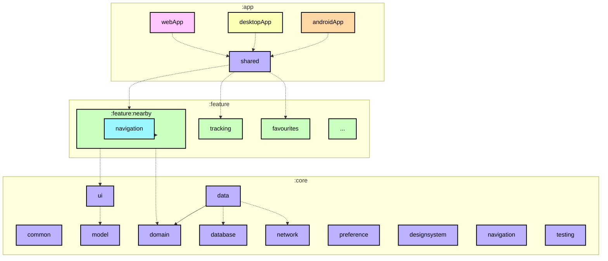
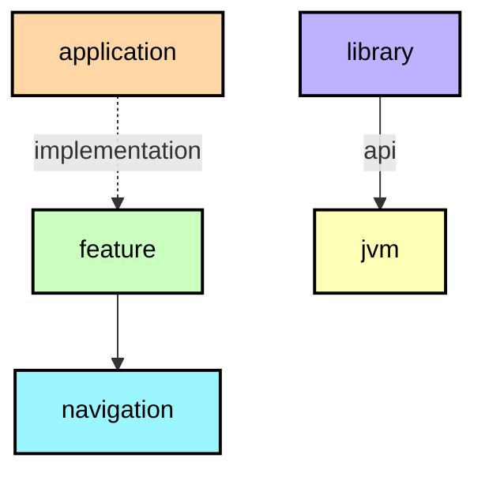

**English** · [Español](ModularizationLearningJourney.es.md)

# Modularization guide

This guide explains how Logroño Bus is divided into Gradle modules and how the build helps keep that
structure consistent. It focuses on how modules depend on one another; for how code is organised
**inside** each module, see the [architecture guide](ArchitectureLearningJourney.md). For the general
principles, see the [official modularization guidance](https://developer.android.com/topic/modularization).

Each module's README contains its dependency graph. These graphs help you understand how the project
fits together; see the [graph for `:app:shared`](../app/shared/README.md) as an example.

## Module types



<details><summary>Graph legend</summary>



A solid arrow represents an `api` dependency; a dotted arrow represents an `implementation`
dependency. Node colours show the convention plugin applied by the module, not the underlying Android
plugin. The generated READMEs use the same colour scheme.

</details>

The graph above illustrates module dependencies. Every module README includes a graph generated from
Gradle, so the diagrams reflect the build configuration instead of relying on manual updates.

The project contains the following types of modules:

### The app modules

`:app:androidApp`, `:app:desktopApp` and `:app:webApp` are the platform entry points. Their projects
and the shared UI host are grouped under `app/`. Each app module contains the setup needed to launch
and package its platform: the Android activity, manifest and signing configuration; the desktop
application and packaging; or the web entry point and webpack output. They depend on `:app:shared` and
any required `core` modules. Other modules do not depend on these app modules.

`:app:shared` hosts the shared UI. It builds the app shell, owns top-level navigation state and
connects the features. It depends on all `core` modules and all feature modules, making it the only
module that brings the full app together.

`app/iosApp` is grouped alongside these projects but remains an Xcode project, not a Gradle module.
It links the iOS framework produced by `:app:shared`.

### Feature modules

Each feature is a pair of Gradle modules:

* `feature:<name>` — the screen, its view model, the display model and its mapper, how each piece is
  built, and the components the screen is made of.
* `feature:<name>:navigation` — only the destination contract: the key that identifies the screen and
  the function that renders it inside the shell.

This split lets one feature navigate to another without depending on its implementation. For
example, `feature:nearby` depends on `feature:stops:navigation`, not on `feature:stops`. The navigation
module stays small because it contains only the destination contract and its serialization.

A feature module must not depend on another feature module. If two features need the same thing, it
belongs in a `core` module.

### Core modules

Core modules hold code shared between features. They may depend on other core modules, never on a
feature or an app module. Their order is the order of the layers:

| Module | Responsibility |
|---|---|
| `core:model` | The domain models the app talks about (`Stop`, `DepartureTime`, `BusLocation`, `Route`, `TrackingView`). No framework types. |
| `core:domain` | Use cases and the rules that must not live in a screen: trip completion, direction resolution, stop ETAs, rider stop state. |
| `core:data` | Repository implementations that combine network, database and preferences into the flows the domain consumes. |
| `core:network` | Translates what the service answers into domain models; its types do not leave the module. |
| `core:database` | Stores the catalogue and the stops you follow, with explicit migrations and no destructive fallback. |
| `core:preference` | Stores small settings (theme, language, last line) with immediate reads. |
| `core:common` | Small shared utilities, without a layer of its own. |
| `core:device` | Platform capabilities (location and friends) behind an `expect`/`actual`. |
| `core:ui` | The display models screens share, their mappers, the composite components and the map. |
| `core:designsystem` | Theme, tokens, typography, icons and the primitives every screen uses. |
| `core:navigation` | The shell that decides which screen is shown and how you go back. |
| `core:testing` | Fakes, builders and the `MainDispatcherRule`. |

### Miscellaneous modules

`app/iosApp` is not a Gradle module: it is the Xcode project that links the static framework produced
by `:app:shared` and starts the Compose UI.

## Convention plugins

Most modules use the same plugins, targets, namespace rules and base dependencies. To avoid copying
that setup into every `build.gradle.kts`, the build applies a **convention plugin** from `build-logic`:

| Plugin | What it applies |
|---|---|
| `logronobus.kmp.library` | Kotlin Multiplatform + Android library, the four targets (`jvm`, `iosArm64`, `iosSimulatorArm64`, `wasmJs`), `namespace` derived from the module path, `compileSdk`/`minSdk` from the version catalog, JVM 17, default hierarchy |
| `logronobus.kmp.compose` | Library + Compose Multiplatform + the Compose compiler |
| `logronobus.android.application` | Android application + Compose + the SDK levels from the version catalog |
| `logronobus.koin` | KSP, the Koin compiler plugin and the generated source wiring |
| `logronobus.serialization` | Kotlin serialization |
| `logronobus.kmp.navigation` | Library + serialization + Navigation 3 |
| `logronobus.kmp.feature` | Library + Compose + Koin + serialization + the shared UI stack and the test stack |
| `logronobus.spotless` | Spotless with ktlint (`.editorconfig` holds the rules) and the license header |

The result is that a module only declares what is specific to it:

```kotlin
plugins {
    id("logronobus.kmp.feature")
}

kotlin {
    sourceSets {
        commonMain.dependencies {
            implementation(project(":core:domain"))
            implementation(project(":feature:stops:navigation"))
        }
    }
}
```

Two implementation choices are worth noting:

* Convention plugins are **class-based**: each concern has its own `Plugin<Project>` in
  `build-logic/convention`, registered with an id in `gradlePlugin { }`. Shared setup is kept in
  nearby helper functions such as `configureKotlinMultiplatform`, `libs` and `requiredLibrary`, rather
  than repeated in each module.
* `build-logic` uses the root version catalog
  (`versionCatalogs { create("libs") { from(files("../gradle/libs.versions.toml")) } }`). This keeps
  dependency versions in one place, including versions used by the convention plugins.

## Dependency graphs

Every module has its own `README.md` with a module graph, for example
[`:feature:nearby`](../feature/nearby/README.md). The graphs are produced by the
`logronobus.module-graph` plugin in `build-logic`, ported from the same approach Now in Android
uses:

* `./gradlew graphDump` writes the graphs to a scratch directory.
* `./gradlew graphUpdate` rewrites the `README.md` of every module, creating it when missing.

The task reads Gradle's actual dependency graph. For each edge, it records whether the dependency uses
`api` or `implementation`; the arrow style shows which one. It groups nodes by module path and colours
them by convention plugin, making it easy to distinguish features, navigation contracts, core
libraries, applications and JVM modules.

Because the graphs come from the build configuration, they stay in sync without a separate module
list to maintain. Modules that are removed from the build disappear from the graphs the next time you
run the task. `graphUpdate` is part of the build and uses the configuration cache, so an unchanged run
finishes quickly.

The graphs document dependencies but do not enforce architecture rules. For example, Gradle will
still compile if one feature depends on another; that dependency will appear in the graph when it is
next generated.

## Sources

The strategy follows the official guidance and derives from the modularization work published by the
Now in Android team:

* [Guide to app modularization](https://developer.android.com/topic/modularization) — the theory:
  what a module is for, how to split by feature and by layer.
* [Modularization patterns](https://developer.android.com/topic/modularization/patterns) — the
  patterns applied here: feature modules with a navigation contract, `api` vs `implementation`.
* [Now in Android's Modularization learning journey](https://github.com/android/nowinandroid/blob/main/docs/ModularizationLearningJourney.md)
  — the reference this document is modelled on, including the per-module graphs.
* [Now in Android `build-logic`](https://github.com/android/nowinandroid/tree/main/build-logic) —
  the convention plugin approach and the graph generator that `build-logic` here was ported from.
* [Sharing build logic between subprojects](https://docs.gradle.org/current/userguide/sharing_build_logic_between_subprojects.html)
  — Gradle's own guide to convention plugins.
* [Kotlin Multiplatform](https://kotlinlang.org/docs/multiplatform.html) — how targets and source
  sets work, which is what the convention plugins configure.
