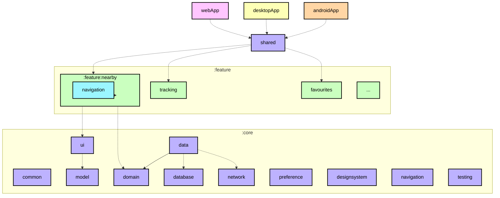
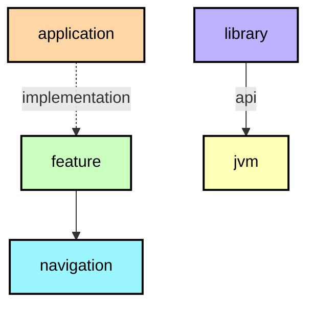

**English** · [Español](ModularizationLearningJourney.es.md)

# Modularization guide

Here you will learn how Logroño Bus is split into Gradle modules and how the build
keeps that structure from decaying. This is the guide for how modules relate to each other; how the
code **inside** each one is written is in the
[architecture guide](ArchitectureLearningJourney.md). For the theory behind modularization,
check out [the official guidance](https://developer.android.com/topic/modularization).

**IMPORTANT:** Every module has a dependency graph in its README
([example for the `shared` module](../shared/README.md)) which can be useful for understanding the
overall structure of the project.

## Module types



<details><summary>Graph legend</summary>



A solid arrow is an `api` dependency, a dotted arrow is `implementation`. The colour of a node is the
convention plugin the module applies, not the Android plugin under it. We use the same colours in all
the generated READMEs.

</details>

**Top tip:** a module graph (shown above) can be useful during modularization planning for
visualizing dependencies between modules. That is why every module here carries one, generated from
Gradle rather than drawn by hand.

The project contains the following types of modules:

### The app modules

`androidApp`, `desktopApp` and `webApp` are the three entry points. They hold only what belongs to a
platform: the Android activity, the signing configuration and the manifest; the desktop application
and its packaging; the web entry point and its webpack output. They depend on `shared` and on the
core modules they need, and nothing depends on them.

`shared` is the UI host: it composes the shell, owns the app-level navigation state and wires the
features together. It depends on all the `core` modules and on every feature, and it is the only
module that knows about all of them.

### Feature modules

Each feature is a pair of Gradle modules:

* `feature:<name>` — the screen, its view model, the display model and its mapper, how each piece is
  built, and the components the screen is made of.
* `feature:<name>:navigation` — only the destination contract: the key that identifies the screen and
  the function that renders it inside the shell.

That split exists so a feature can navigate to another feature without seeing its implementation:
`feature:nearby` depends on `feature:stops:navigation`, never on `feature:stops`. The navigation
module is three lines of build configuration because it only carries the contract and its
serialization.

A feature module must not depend on another feature module. If two features need the same thing, it
belongs in a `core` module.

### Core modules

Core modules hold code shared between features. They may depend on other core modules, never on a
feature or an app module. Their order is the order of the layers:

| Module | Responsibility |
|---|---|
| `core:model` | The domain models the app talks about (`Stop`, `DepartureTime`, `BusLocation`, `Route`, `TrackingView`). No framework types. |
| `core:domain` | Use cases and the rules that must not live in a screen: trip completion, direction resolution, stop ETAs, rider stop state. |
| `core:data` | Repository implementations that combine network, database and preferences into the flows the domain consumes. |
| `core:network` | Translates what the service answers into domain models; its types do not leave the module. |
| `core:database` | Stores the catalogue and the stops you follow, with explicit migrations and no destructive fallback. |
| `core:preference` | Stores small settings (theme, language, last line) with immediate reads. |
| `core:common` | Small shared utilities, without a layer of its own. |
| `core:device` | Platform capabilities (location and friends) behind an `expect`/`actual`. |
| `core:ui` | The display models screens share, their mappers, the composite components and the map. |
| `core:designsystem` | Theme, tokens, typography, icons and the primitives every screen uses. |
| `core:navigation` | The shell that decides which screen is shown and how you go back. |
| `core:testing` | Fakes, builders and the `MainDispatcherRule`. |

### Miscellaneous modules

`iosApp` is not a Gradle module: it is the Xcode project that links the static framework produced by
`shared` and starts the Compose UI.

## Convention plugins

Almost every module shares the same `plugins { }` block, the same targets, the same namespace rule and
almost the same dependency stack. Instead of copying that into every `build.gradle.kts`, the build
applies a **convention plugin** from `build-logic`:

| Plugin | What it applies |
|---|---|
| `logronobus.kmp.library` | Kotlin Multiplatform + Android library, the four targets (`jvm`, `iosArm64`, `iosSimulatorArm64`, `wasmJs`), `namespace` derived from the module path, `compileSdk`/`minSdk` from the version catalog, JVM 17, default hierarchy |
| `logronobus.kmp.compose` | Library + Compose Multiplatform + the Compose compiler |
| `logronobus.android.application` | Android application + Compose + the SDK levels from the version catalog |
| `logronobus.koin` | KSP, the Koin compiler plugin and the generated source wiring |
| `logronobus.serialization` | Kotlin serialization |
| `logronobus.kmp.navigation` | Library + serialization + Navigation 3 |
| `logronobus.kmp.feature` | Library + Compose + Koin + serialization + the shared UI stack and the test stack |
| `logronobus.spotless` | Spotless with ktlint (`.editorconfig` holds the rules) and the license header |

The result is that a module only declares what is specific to it:

```kotlin
plugins {
    id("logronobus.kmp.feature")
}

kotlin {
    sourceSets {
        commonMain.dependencies {
            implementation(project(":core:domain"))
            implementation(project(":feature:stops:navigation"))
        }
    }
}
```

Two decisions worth naming:

* The plugins are **class-based convention plugins**: one `Plugin<Project>` per concern in
  `build-logic/convention`, each registered with its own id in `gradlePlugin { }`. The code they
  share lives in helper functions next to them (`configureKotlinMultiplatform`, `libs`,
  `requiredLibrary`), so a module never repeats it.
* `build-logic` reuses the root version catalog
  (`versionCatalogs { create("libs") { from(files("../gradle/libs.versions.toml")) } }`), so a
  version bump is one edit and it reaches the plugins too.

## Dependency graphs

Every module has its own `README.md` with a module graph, for example
[`:feature:nearby`](../feature/nearby/README.md). The graphs are produced by the
`logronobus.module-graph` plugin in `build-logic`, ported from the same approach Now in Android
uses:

* `./gradlew graphDump` writes the graphs to a scratch directory.
* `./gradlew graphUpdate` rewrites the `README.md` of every module, creating it when missing.

The task reads the real dependency graph from Gradle and records, for each edge, whether it came
from an `api` or an `implementation` configuration, which is what the arrow style shows. Nodes are
grouped into nested subgraphs by path and coloured by convention plugin, so a graph tells you at a
glance whether you are looking at a feature, a navigation contract, a core library, an application or
a plain JVM module.

Because the input is the build itself, the graphs cannot drift from the code: there is no list of
modules to maintain, and a module that stops existing disappears from every graph on the next run.
The task is part of the build, so `graphUpdate` reuses the configuration cache and a no-op run takes
seconds.

What a graph does not do is prevent anything. If a feature depends on another feature, the build still
compiles; the dependency shows up in the graph on the next run, and that is where you see it.

## Sources

The strategy follows the official guidance and derives from the modularization work published by the
Now in Android team:

* [Guide to app modularization](https://developer.android.com/topic/modularization) — the theory:
  what a module is for, how to split by feature and by layer.
* [Modularization patterns](https://developer.android.com/topic/modularization/patterns) — the
  patterns applied here: feature modules with a navigation contract, `api` vs `implementation`.
* [Now in Android's Modularization learning journey](https://github.com/android/nowinandroid/blob/main/docs/ModularizationLearningJourney.md)
  — the reference this document is modelled on, including the per-module graphs.
* [Now in Android `build-logic`](https://github.com/android/nowinandroid/tree/main/build-logic) —
  the convention plugin approach and the graph generator that `build-logic` here was ported from.
* [Sharing build logic between subprojects](https://docs.gradle.org/current/userguide/sharing_build_logic_between_subprojects.html)
  — Gradle's own guide to convention plugins.
* [Kotlin Multiplatform](https://kotlinlang.org/docs/multiplatform.html) — how targets and source
  sets work, which is what the convention plugins configure.
