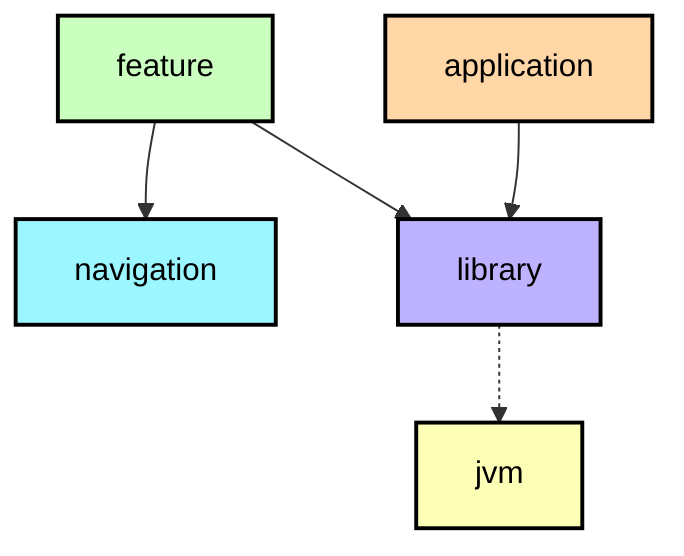

# `:feature:favourites:navigation`

## Module dependency graph

<!--region graph-->
```mermaid
---
config:
  layout: elk
  elk:
    nodePlacementStrategy: SIMPLE
---
graph TB

classDef feature fill:#CAFFBF,stroke:#000,stroke-width:2px,color:#000;
classDef navigation fill:#9BF6FF,stroke:#000,stroke-width:2px,color:#000;
classDef library fill:#BDB2FF,stroke:#000,stroke-width:2px,color:#000;
classDef application fill:#FFD6A5,stroke:#000,stroke-width:2px,color:#000;
classDef jvm-library fill:#FDFFB6,stroke:#000,stroke-width:2px,color:#000;
classDef kmp-library fill:#FFC6FF,stroke:#000,stroke-width:2px,color:#000;
classDef android-library fill:#E0E0E0,stroke:#000,stroke-width:2px,color:#000;
classDef unknown fill:#FFADAD,stroke:#000,stroke-width:2px,color:#000;
```

<details><summary>📋 Graph legend</summary>



</details>
<!--endregion-->
